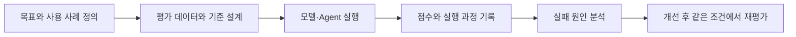

## Intro

Agent나 LLM을 설계할 때 모델 자체만큼 중요한 것이 **평가**다. 답변이 그럴듯해 보여도, 검색한 문서와 맞지 않거나 실제 사용자의 문제를 해결하지 못할 수 있다. 모델을 바꿨을 때 무엇이 좋아졌는지도 기준이 없으면 알기 어렵다.

추천 시스템 연구에서는 순위 지표와 비교 실험을 사용했고, LLM 기반 추천과 문서 검색 Agent를 만들면서는 답변의 유용성, 근거, 검증 과정까지 살펴봤다. 그 경험을 바탕으로 **직접 적용한 평가**와 **앞으로 평가 체계를 만들 때 필요한 개념**을 함께 정리해 보려 한다.

> 좋은 평가는 점수 하나를 만드는 일이 아니라, **어디서 실패했는지 찾고 다음 개선을 결정할 수 있게 하는 과정**이라고 생각한다.

## Evaluation Process

평가를 설계할 때는 먼저 사용자가 원하는 결과를 정하고, 이를 확인할 수 있는 사례와 기준을 만든다. 그다음 시스템을 실행해 결과를 기록하고, 실패 유형을 살핀 뒤 같은 조건에서 다시 평가한다.

여기서 **평가 데이터**는 질문과 기대 결과를 모은 사례집, **rubric**은 어떤 답변에 높은 점수를 줄지 적어 둔 채점 기준이다. 숫자로 바로 계산되는 지표도 있고, 사람이 읽거나 LLM이 기준에 따라 판단해야 하는 항목도 있다.

## Experiments & Lessons

### 01. 추천 시스템 — 맞는 아이템을 얼마나 위에 놓았는가

추천 모델은 **추천 목록의 순서**가 중요하다. 연구에서 사용한 Recall@K, NDCG@K 같은 지표는 정답 아이템이 상위 K개에 들어왔는지, 그 안에서도 얼마나 높은 위치에 있는지 살펴본다.

이전 [기존 연구 모델 최적화 실험]({{ '/posts/preq-inference-optimization-part-1/' | relative_url }})에서도 실행 시간을 줄이는 후보를 고르기 전에 Validation NDCG의 허용 하락 폭을 정했다. 연산 변경 뒤에는 출력 오차와 사용자별 Top-K 목록도 확인했다. **빨라진 설정이 추천 결과를 지나치게 바꾸면 채택하지 않기 위해서**다.

단, Top-K 목록이 같다는 사실만으로 새로운 추천 모델의 정확도가 높아졌다고 말할 수는 없다. 그 실험은 동일한 학습 모델의 **실행 방식을 비교**한 것이며, 논문의 전체 정확도를 다시 검증한 실험은 아니었다.

### 02. LLM 기반 추천 — 좋은 답변을 항목별로 나누어 보기

LLM이 추천 이유를 설명할 때는 순위 지표만으로 충분하지 않다. 사용자의 요청에 맞는지, 근거가 사실인지, 설명이 도움이 되는지를 함께 봐야 한다. 진행했던 지식그래프 기반 설명형 추천 연구에서는 **GPT-4o를 LLM-as-a-Judge로 사용해** 답변을 여러 기준에서 비교했다.

**LLM-as-a-Judge**는 다른 LLM에 채점자 역할을 맡기는 방식이다. 응답 하나를 기준에 따라 평가하는 *pointwise*, 두 응답 중 더 나은 쪽을 고르는 *pairwise* 방식으로 볼 수 있다. 당시에는 유용성, 관련성, 정확성, 설명의 깊이·상세함 등 답변 품질을 나누어 보려 했다.

이런 평가는 사람이 모든 결과를 읽기 어려울 때 비교를 돕지만, 판정이 곧 객관적인 정답이 되는 것은 아니다. 채점 문구나 답변 순서가 달라지면 판단이 흔들릴 수 있으므로, 중요한 사례는 원문 근거와 함께 다시 확인해야 한다.

### 03. 문서 검색 Agent — 답변 이전의 과정을 보기

[SSD 예지보전 프로젝트](https://github.com/RogersHun/Dexon_Project)에서는 SSD 매뉴얼을 검색해 질문에 답하는 Agent를 만들었다. 이때 답변만 평가하면 **검색이 잘못됐는지, 검색은 맞았지만 생성 단계에서 근거를 벗어났는지** 구분하기 어렵다.

그래서 검색은 키워드·의미 검색 결과를 합치고 다시 순위를 매기는 구조로 두었고, `Verifier`가 작성된 답변을 검색한 매뉴얼 내용과 대조하도록 했다. Coordinator부터 검색·작성·검증까지의 실행 흐름도 trace로 남겼다. **trace는 Agent가 어떤 단계와 도구를 거쳐 답에 이르렀는지 보여주는 기록**이다.

여기서 검증기의 판단은 안전장치이지만, 사람이 확인한 정답과 같지는 않다. 이 프로젝트에서 모든 실패를 유형별로 집계한 공식 벤치마크를 구축했다고 볼 수도 없다. 다음에는 검색 실패, 근거 누락, 근거와 모순되는 답변을 따로 라벨링해 어느 단계에서 문제가 생겼는지 측정해 보고 싶다.

## Evaluation Checklist

프로젝트 경험을 정리해 보니, 같은 “평가”라도 확인하려는 대상에 따라 기준이 달랐다.

| 평가 대상 | 확인할 질문 | 살펴볼 방법 |
|---|---|---|
| 추천 순위 | 필요한 아이템이 상위에 있는가? | Recall@K, NDCG@K와 사용자별 목록 비교 |
| 검색 결과 | 답을 만드는 데 필요한 문서를 찾았는가? | 정답 근거 문서의 검색 순위, 실패 사례 검토 |
| 최종 답변 | 요청을 해결하고 근거를 지키는가? | rubric에 따른 사람·LLM 평가, 원문 대조 |
| Agent 실행 과정 | 어느 단계에서 실패했는가? | tool/검색/검증 trace와 실패 유형 분석 |
| 시스템 비용 | 품질을 지키면서 실행 가능한가? | 같은 조건에서 지연 시간·메모리·비용 비교 |

특히 **retrieval 평가**와 **최종 답변 평가**는 분리하는 편이 좋다. 필요한 문서를 찾았는데 답변이 틀렸다면 생성·검증 쪽을 고쳐야 하고, 문서를 못 찾았다면 검색 쪽을 먼저 고쳐야 하기 때문이다.

## Validate Next

실무에서 신뢰할 만한 평가 체계를 만들려면 다음 단계가 필요하다고 느꼈다. 이 항목들은 **이번 프로젝트에서 모두 구현했다는 뜻이 아니라**, 기존 평가의 한계를 보완하기 위한 계획이다.

1. **작은 사람 평가 세트 만들기:** 정답과 근거가 확인된 실제 질문을 모으고, 평가자 사이에 판단 차이가 나는 사례를 기록한다.
2. **rubric과 자동 채점 검증하기:** 사람이 매긴 결과와 LLM judge의 판단을 대조해, 채점 기준이 모호하거나 특정 답변 형식에 치우치지 않는지 확인한다.
3. **Agent 실패 유형 기록하기:** 검색 누락, 잘못된 도구 선택, 근거 없는 서술, 검증 실패를 구분해 개선 효과를 측정한다.
4. **평가 데이터 누수 막기:** 개선 과정에서 본 사례와 최종 확인에 쓸 사례를 분리한다. 같은 문제에만 맞춘 수정이 전체 성능 향상처럼 보이지 않도록 하기 위해서다.

LLM·Agent 평가에는 정답률뿐 아니라 **근거의 신뢰성, 실제 과제의 해결 여부, 실패를 재현할 수 있는 기록**이 필요하다. 다음으론 점수를 높이는 것만큼, 그 점수가 무엇을 설명하고 무엇을 설명하지 못하는지도 함께 확인하려 한다.

## References

- [기존 연구 최적화 실험]({{ '/posts/preq-inference-optimization-part-1/' | relative_url }})
- [SSD 예지보전 프로젝트](https://github.com/RogersHun/Dexon_Project)
